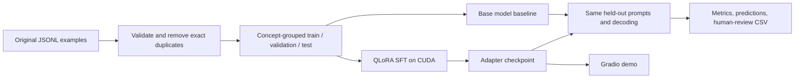

# Plain-language ML tutor: a small QLoRA lab

This repository is a reproducible learning project for instruction-tuning `Qwen/Qwen2.5-1.5B-Instruct` with QLoRA. The task is narrow: explain a machine-learning concept with three labeled parts—**Definition**, **Example**, and **Caveat**. That makes formatting easy to check while leaving factual accuracy and usefulness to human review.

The included 52-row teaching dataset is a small, project-specific seed set covering 13 concepts. It is suitable for exercising data preparation and a short experiment, not for claiming general improvements. Examples were prepared for this repository and have not received an independent subject-matter review. Review the data before using it as an educational resource. There is no third-party training corpus in this baseline.

## Hardware and scope

The project authoring machine was an Apple M5 Mac with 24 GB unified memory. PyTorch was present, but its runtime reported neither CUDA nor MPS. The project therefore does not claim a completed QLoRA run. Training has a fail-fast CUDA check; use a Linux NVIDIA GPU runtime for the training smoke test and experiment. The current system can run the CPU-only data, configuration, metrics, and CI tests.

The base model is [Qwen2.5-1.5B-Instruct](https://huggingface.co/Qwen/Qwen2.5-1.5B-Instruct), whose model card lists Apache-2.0. Keep the model license and notices with any redistribution. This repository's MIT license applies to this project's code and original example data; it does not replace the model license or the terms of any later dataset you add.

## Setup

Use Python 3.11–3.13 on the training runtime. Install `uv`, then sync the locked dependencies. `uv.lock` pins the transitive packages as well as the direct versions in `pyproject.toml`:

```bash
python -m pip install uv
uv sync --locked --python 3.13 --extra dev --extra model --extra train --extra demo
source .venv/bin/activate
```

For CPU-safe local development and tests, install only:

```bash
uv sync --locked --python 3.13 --extra dev
```

PyTorch wheels vary by platform and accelerator. If the default resolved wheel does not match your NVIDIA runtime, install the matching build from the [official PyTorch selector](https://pytorch.org/get-started/locally/) and follow the same environment's package-lock workflow. Confirm hardware before training:

```bash
python -c 'import torch; print(torch.__version__, torch.cuda.is_available())'
nvidia-smi
```

Do not put Hugging Face tokens or credentials into source control. The public base model does not require a token for ordinary downloads. If gated models are substituted, use the runtime's secret manager.

## Reproducible workflow

```bash
make prepare
make test
make lint
make baseline
make smoke
make train
make evaluate-base
make evaluate-adapter
make app
```

The first baseline/evaluation and the GPU smoke run download model weights. The training smoke run uses up to four train rows, two validation rows, and exactly one optimizer step. Check its adapter parameter count and finite loss before starting the longer run. `make train` uses validation loss, early stopping, checkpoints, gradient accumulation, gradient checkpointing, and adapter-only saving. It does not merge the adapter into base weights.

Training settings are in `configs/small.yaml`. Override paths from the command line when needed:

```bash
python -m qlora_lab.train --config configs/small.yaml \
  --train data/processed/train.jsonl --validation data/processed/validation.jsonl \
  --resume-from-checkpoint outputs/adapter/checkpoint-3
```

`make baseline` evaluates the base model; `make evaluate-adapter` uses the adapter in `outputs/adapter`. Both use the exact same held-out `data/processed/test.jsonl`, prompt formatting, decoding arguments, and hardware measurements. Results are written beneath `outputs/`, which is ignored by Git. Review `human-review.csv` for both runs side by side; ratings are left blank until a person reviews them.

## What the metrics mean

The custom evaluator reports required-label/order compliance, word count, latency, and category-level aggregates. Format compliance is not a correctness metric. The human-review sheet supports comparison of factual accuracy, clarity, completeness, and whether the caveat is useful. Report the number of reviewed examples and reviewer rubric with any conclusions. Do not use the held-out test set to choose hyperparameters; use the validation split for that.

No baseline or fine-tuned model evaluation has been run as part of this repository creation: the authoring runtime had no detected training accelerator and did not download the base weights. The results table in `MODEL_CARD.md` is intentionally marked not run until an actual evaluation writes its outputs.

## Architecture



## Repository map

- `src/qlora_lab/data/prepare.py`: field validation, invalid-row reporting, exact deduplication, concept-grouped deterministic splits, and near-duplicate candidates.
- `src/qlora_lab/data/io.py`: shared JSONL loading for training and evaluation.
- `src/qlora_lab/data/formatting.py`: the model's shared system prompt and TRL chat prompt/completion records.
- `src/qlora_lab/config.py`: validated settings shared by training and inference.
- `src/qlora_lab/train.py`: QLoRA setup, trainable-adapter check, finite-loss check, early stopping, checkpoint resume, and run metadata.
- `src/qlora_lab/modeling.py`: base or adapter model loading and bounded greedy generation.
- `src/qlora_lab/evaluate.py`: repeatable inference, latency collection, metrics, and human-review export.
- `src/qlora_lab/evaluation/metrics.py`: transparent structural metrics and review file generation; no semantic correctness claim.
- `src/qlora_lab/demo.py` and `app.py`: Gradio interface and launch entry point.
- `tests/`: CPU unit tests, a tiny random-model TRL/PEFT integration run, and an opt-in real CUDA training smoke test.
- `docs/architecture.md`: design reasoning, data flow, limitations, and verification boundaries.
- `MODEL_CARD.md`: model provenance, task scope, and result status.

## Hugging Face Spaces

The root README has Gradio Space metadata. For a useful hosted demo, select a Space runtime with a compatible GPU, install the training/model extras using the documented CUDA-specific PyTorch setup, and configure `ADAPTER_PATH` only if the adapter has been uploaded to a repository you control. Do not upload the adapter or dataset without reviewing licensing and privacy. Without an adapter path, the app loads the base model. Startup downloads roughly 3 GB of base weights; actual memory and startup time depend on the selected hardware and quantization backend.

## License

Project code and included example data: MIT. Base model: Apache-2.0, subject to its included license and notices. See [LICENSE](LICENSE) and [MODEL_CARD.md](MODEL_CARD.md).
